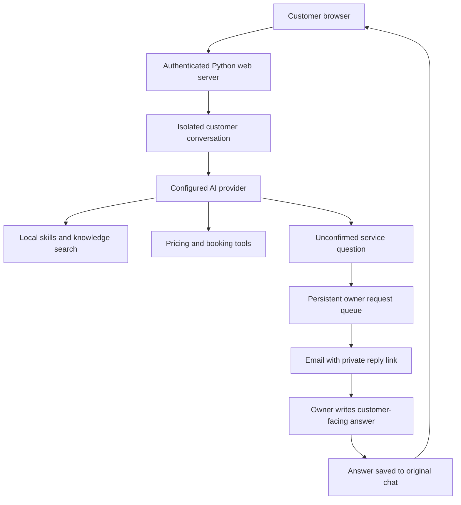

# ProSurfaceAgent

**A floor-services assistant for Pro Surface Works, combining local business knowledge, document understanding, and owner confirmation for questions that need a human answer.**

ProSurfaceAgent helps customers describe a flooring problem, share photos or documents, explore suitable services, request an indicative quote, and arrange the next step. It combines a Python application, a responsive browser interface, editable service knowledge, and business tools for pricing, bookings, and email notifications.

The assistant is designed to ground answers in the project's skills, knowledge-base pages, pricing rules, and confirmed team answers. When a relevant service detail cannot be confirmed, it can ask the owner and deliver the answer back to the customer's original conversation.

> **Repository privacy:** credentials, customer uploads, bookings, conversation databases, owner-reply tokens, local memories, logs, and virtual environments are excluded from Git. The included [.env.example](.env.example) contains empty credential fields only.

## Contents

[Capabilities](#capabilities) · [Architecture](#architecture) · [Quick start](#quick-start) · [Configuration](#configuration) · [Owner confirmation](#owner-confirmation) · [Knowledge and pricing](#knowledge-and-pricing) · [Project layout](#project-layout) · [HTTP interface](#http-interface) · [State and privacy](#state-and-privacy) · [Verification](#verification) · [Deployment](#deployment) · [Current limits](#current-limits)

## Capabilities

| Area | What the application provides |
| --- | --- |
| Customer chat | Responsive desktop/mobile interface, sign-in, service shortcuts, multiline messages, copyable replies, loading feedback, and retry handling. |
| Images | JPG/JPEG, PNG, and WebP uploads with visual assessment through a compatible vision model. |
| Documents | PDF, DOCX, XLSX, TXT, and CSV text extraction. Scanned PDF pages can be sent for visual reading. |
| Attachments | One file per message, previews, drag and drop, pasted images, and validation feedback. |
| Service knowledge | Markdown skills and website-derived knowledge pages loaded locally. |
| Pricing | Rule-based indicative quotes; missing or exceptional pricing can be escalated to the owner. |
| Bookings | Tools for collecting booking details and updating requests. |
| Owner notifications | Email alerts for bookings, newly shared contact details, and questions requiring confirmation. |
| Owner answers | Expiring private reply links, durable pending questions, delivery retries, and automatic updates to the original chat. |
| Conversation isolation | Separate browser conversations, persistent history, and restoration after signing in following a restart. |
| Usage controls | Configurable message limits, request validation, output-token limits, and bounded tool rounds. |
| AI providers | OpenAI, Fireworks AI, Featherless AI, and custom OpenAI-compatible endpoints. |

Included knowledge covers marble and stone care, parquet flooring, vinyl flooring, wood decking, grout work, timber repair, broken-marble polishing, and general floor care.

## Architecture



The model uses a restricted Q/A toolset: `skills_list`, `skill_view`, `data_search`, `price_quote`, `booking`, `ask_owner`, and `get_time`. It has no tools for editing files, running shell commands, managing knowledge, or browsing the public web. Website crawling is a separate maintenance operation.

All model calls pass through `prosurface_agent/llm.py`, which adapts supported request parameters for the selected provider and model.

## Quick start

### Requirements

- Python **3.12 or newer**. The current application has been verified with Python 3.14.
- A configured AI provider and a model supporting the required chat/tool capabilities. Images and scanned PDFs also require vision support.
- SQLite with FTS5 support, used by the session archive.
- SMTP access if owner email notifications are required.

Run commands from the repository root.

### Windows PowerShell

```powershell
git clone https://github.com/Syeed-MD-Talha/ProSurfaceAgent.git
cd ProSurfaceAgent
py -3 -m venv .venv
.\.venv\Scripts\python.exe -m pip install -r requirements.txt
Copy-Item .env.example .env
```

Configure the new local `.env` with one provider's credentials and a web username/password, then start:

```powershell
.\.venv\Scripts\python.exe run_web.py
```

### Linux / macOS

```bash
git clone https://github.com/Syeed-MD-Talha/ProSurfaceAgent.git
cd ProSurfaceAgent
python3 -m venv .venv
.venv/bin/python -m pip install -r requirements.txt
cp .env.example .env
```

Configure the new local `.env`, then start:

```bash
.venv/bin/python run_web.py
```

Open **http://127.0.0.1:8000** and sign in with the configured credentials. Empty login credentials fail closed; the repository ships with no default working password.

An optional port can be supplied with `python run_web.py 8001`. For the terminal interface, run `python run.py`. The terminal retains an interactive owner-answer prompt; browser conversations use the email-link workflow.

## Configuration

Use the deployment environment or a private `.env`. Restart after configuration changes. Process environment variables take precedence over values loaded from `.env`.

### AI provider

| `AI_PROVIDER` | Required settings | Additional behavior |
| --- | --- | --- |
| `openai` | `OPENAI_API_KEY` | `OPENAI_MODEL` defaults to `gpt-4o-mini`. |
| `fireworks` | `FIREWORKS_API_KEY`, `FIREWORKS_MODEL` | Optional `FIREWORKS_VISION_MODEL` selects the vision model. |
| `featherless` | `FEATHERLESS_API_KEY`, `FEATHERLESS_MODEL` | Uses the selected model for vision requests. |
| `custom` | `CUSTOM_API_KEY`, `CUSTOM_BASE_URL`, `CUSTOM_MODEL` | Configure an OpenAI-compatible endpoint and suitable model. |

Set `AI_PROVIDER` explicitly for predictable deployments. If omitted, the first configured provider with a usable model is selected in this order: Fireworks, OpenAI, Featherless, custom.

### Access and usage

| Setting | Purpose | Default |
| --- | --- | --- |
| `WEB_LOGIN_USERNAME` | Web sign-in username | Empty; sign-in fails |
| `WEB_LOGIN_PASSWORD` | Web sign-in password | Empty; sign-in fails |
| `WEB_CHAT_SESSION_LIMIT_PER_MINUTE` | Accepted chat requests per signed-in session in a rolling minute | `30` |
| `WEB_CHAT_SERVER_DAILY_LIMIT` | Accepted chat requests across the server per UTC day | `200` |
| `SAVE_UPLOADS` | Retain customer photo bytes when set to `1` | `0` |

Rate limits use positive integers. Invalid or nonpositive settings fall back to defaults. Rejected requests receive HTTP `429`, a `Retry-After` header, and a customer-facing wait message.

**Message limits are not a billing cap.** Counters are currently held in memory and reset on server restart. One chat turn can make several model calls; visual analysis and context compression can add calls. Apply the provider's spending controls independently.

### Owner email and replies

| Setting | Purpose | Default |
| --- | --- | --- |
| `OWNER_NOTIFY_EMAIL` | Owner's notification inbox | Empty; notifications disabled |
| `SMTP_HOST` | Outgoing SMTP server | `smtp.gmail.com` |
| `SMTP_PORT` | SMTP port using STARTTLS | `587` |
| `SMTP_USER` | SMTP login / sender account | Empty |
| `SMTP_PASSWORD` | SMTP password or provider-specific app password | Empty |
| `OWNER_REPLY_BASE_URL` | Public HTTPS origin used in owner reply links | Empty; generates a local URL |
| `OWNER_REPLY_TOKEN_TTL_HOURS` | Owner reply-link lifetime | `168` hours |
| `WEB_STATE_DIR` | Private persistent browser-state directory | `.prosurface-agent/web-state` |

Leave `WEB_STATE_DIR` **unset** for the default; an empty value selects the working directory. For hosting, use a private writable directory outside the public document root.

Set `OWNER_REPLY_BASE_URL` to an origin such as `https://chat.example.com`, without credentials, a path, query, or fragment. Hosted origins must use HTTPS. An empty setting generates a localhost link usable on the server computer only.

## Owner confirmation

1. A customer asks a service question the available knowledge and tools cannot confirm.
2. The bot saves a pending question linked to that conversation and immediately says it will check with the team.
3. A background worker emails the owner a private reply link. SMTP failures retry up to three times, including recovery after restarts.
4. The owner reviews the question and recent context, then writes the exact customer-facing answer.
5. The answer passes the existing output checks, is saved to the original chat, and appears in the active browser within the polling interval, normally about four seconds.
6. The confirmation becomes context for later questions in that conversation. It does not update general prices or shared knowledge.

Unrelated questions should not be escalated. Routing combines the prompt's service-only rule with an additional relevance check in the owner tool.

Reply links expire and accept one answer. Tokens are stored as hashes and authorize only their associated question. Pending copies of the same customer question are deduplicated. Client retries with the same request ID reuse a completed response instead of making another model call.

**The owner answers through the link in the email. Direct email replies are not processed.** If email is not configured, the bot asks the customer to contact ProSurface directly rather than claiming the owner was notified.

See [OWNER_REPLY_SETUP.md](OWNER_REPLY_SETUP.md) for detailed deployment and acceptance checks.

## Knowledge and pricing

- **Skills:** `.prosurface-agent/skills/<category>/<skill-name>/SKILL.md`. Each begins with YAML `name` and `description` fields; its directory name is the callable name. Keep skills focused and descriptions useful as trigger hints.
- **Knowledge pages:** `prosurfaceworks_knowledge_base/pages/*.md`. Pages need frontmatter with a `source_url`; very short bodies are skipped by retrieval.
- **Indicative prices:** `PRICING_RULES` in `prosurface_agent/business/pricing.py`.
- **Assistant wording/routing:** `prosurface_agent/prompts.py`.
- **Input, tool-output and final-output defenses:** `prosurface_agent/guardrails/`.

Validate local retrieval without crawling or replacing content:

```bash
python scripts/rebuild_kb.py --verify-only
```

Running `python scripts/rebuild_kb.py` **without** `--verify-only` crawls the live website and regenerates pages. Review that operation first: it can overwrite hand-maintained knowledge.

Skills, pages, prompts, and configuration are cached during operation. Restart the server after changing them or updating prices.

## Project layout

```text
ProSurfaceAgent/
├── .env.example                       # Empty credential template
├── .gitignore                         # Secret, customer-data and state exclusions
├── .prosurface-agent/skills/           # Curated Markdown knowledge
├── prosurface_agent/
│   ├── agent.py                       # Agent setup, tools and session lifecycle
│   ├── service.py                     # Chat turns, vision and response loops
│   ├── web.py                         # HTTP routes, auth, quotas and isolation
│   ├── web_state.py                   # Persistent chats and owner request queue
│   ├── config.py / providers.py        # Settings and AI provider registry
│   ├── llm.py                         # Provider/model parameter compatibility
│   ├── documents.py / pdf.py          # Upload extraction
│   ├── business/                      # Pricing, bookings, SMTP and owner workflow
│   ├── data/ / skills/                # Local retrieval and skill loading
│   ├── context/ / sessions/ / memory/ # Compression and conversation storage
│   ├── guardrails/                    # Input and output defenses
│   └── ui/                           # Chat, sign-in and owner reply pages
├── prosurfaceworks_knowledge_base/pages/
├── scripts/                           # Knowledge maintenance and local restart
├── tests/                             # Unit and workflow checks
├── OWNER_REPLY_SETUP.md
├── requirements.txt
├── run.py                             # Terminal entry point
└── run_web.py                         # Browser entry point
```

The separate Admin Agent coding harness is not part of this repository.

## HTTP interface

| Method | Route | Access / behavior |
| --- | --- | --- |
| `GET` | `/` | Sign-in or authenticated chat page |
| `POST` | `/api/login` | Configured credentials establish an auth session and private browser-chat cookie |
| `POST` | `/api/logout` | Ends auth; the private chat cookie retains conversation continuity |
| `POST` | `/api/chat` | Requires auth and the chat cookie; accepts a message and optional supported attachment |
| `GET` | `/api/chat/history?after=<id>` | Requires auth and the chat cookie; returns only that conversation's messages and pending confirmations |
| `GET` | `/api/health` | Public health/configuration flags; returns no credentials |
| `GET` | `/owner/reply` | Reply page; the email-link token is needed to read its question |
| `GET` | `/api/owner/question` | Requires the question's bearer token |
| `POST` | `/api/owner/answer` | Requires the question's bearer token; accepts one answer |

Integrations should create a unique `request_id` for each new message and preserve it on retries. Login cookies and owner capabilities are distinct; an owner link cannot list other conversations or questions.

## State and privacy

| Location | Contents | Committed? |
| --- | --- | --- |
| `.prosurface-agent/skills/` | Curated application knowledge | Yes, except usage/archive state |
| `prosurfaceworks_knowledge_base/pages/` | Project knowledge pages | Yes |
| `.env` and local environment variants | Credentials and deployment settings | No |
| `.prosurface-agent/web-state/` | Chats, model snapshots, owner questions, token hashes and web archive | No |
| `workspace/` | Bookings, optional saved uploads, generated work and logs | No |
| `~/.prosurface-agent/` | Terminal archive and local memory configuration | Outside this repository; do not publish |

Customer photo bytes are not saved by default. Visual descriptions, extracted document text and messages can still be stored in conversation history. Material needed to answer a question is sent to the configured AI provider; owner escalations send the question and recent context through SMTP.

The private chat cookie supports returning to the same conversation for 30 days. A restart requires signing in again. Clearing cookies or switching browsers creates a separate conversation; individual customer accounts and cross-device history recovery are not implemented.

## Verification

Tests cover extraction, business tools, auth, provider compatibility, rate limits, owner-link security, customer isolation, duplicate requests, mail retry recovery, and persistence across restarts.

From a local development checkout that may have SMTP configured, this command disables default owner email in the test process:

```bash
python -c "import os; os.environ['OWNER_NOTIFY_EMAIL']=''; os.environ['SMTP_USER']=''; os.environ['SMTP_PASSWORD']=''; import pytest; raise SystemExit(pytest.main(['tests/', '-q']))"
```

In a clean checkout without live configuration, `python -m pytest tests/ -q` also runs the suite. Workflow checks use temporary databases, stubbed models and simulated mail. Deliberate live-model smoke tests are separate operations that use provider credits.

To restart the local Windows server and check health:

```powershell
.\.venv\Scripts\python.exe scripts/restart_qa_server.py
```

This helper stops listeners on the configured QA port and starts a background server. Use the hosting environment's process supervisor for hosted deployments.

## Deployment

The web entry point binds to `127.0.0.1`. A hosted installation needs:

1. An environment running a persistent Python process with the required dependencies.
2. An HTTPS reverse proxy forwarding application routes to the loopback listener.
3. Secrets supplied through private environment configuration.
4. `OWNER_REPLY_BASE_URL` set to the final HTTPS origin for owner links usable from other devices.
5. A private persistent `WEB_STATE_DIR`, preserved across releases, with appropriate customer-data retention and backups.
6. A single application process. Auth sessions, caches and rate counters are currently process-local.

For a planned Hostinger deployment, ensure the chosen hosting environment provides those capabilities. This repository contains the Python application; it does not include completed Hostinger provisioning or domain setup.

Do not serve the repository or state directories as a public static document root. Public traffic should reach application routes through the reverse proxy. Apply proxy-level access/abuse controls appropriate to the deployment; login attempts currently have no application-level throttle.

## Current limits

- **Attachments:** 8 MiB for images and 10 MiB for documents. Legacy `.doc` / `.xls`, archives, executables, audio and video are not supported.
- **Extraction and vision:** extraction has size/expansion limits and can truncate large documents. Vision depends on provider capability and cannot guarantee reliable material identification or damage diagnosis.
- **Model usage:** the web loop permits up to seven model response calls per turn; vision and compression can add calls. The web output allowance is 1,024 tokens per response call.
- **Quotas:** request counters reset on restart and cannot impose a monetary budget. Additional login sessions can bypass the per-session minute limit; the server daily cap is shared within that process.
- **Concurrency:** customer turns are serialized by the web agent lock. The app has no distributed queue or multi-worker session store.
- **Owner access:** private links authorize their holders and are scoped to one question; there is no separate owner account dashboard.
- **Accuracy and abuse:** model routing and defense checks are not guarantees of accuracy or complete abuse prevention. Review business facts, prices and deployment settings before use.

Contributions should preserve customer isolation, exclude credentials and runtime data from commits, and pass relevant tests. Changes to prompt-injection defenses deserve explicit security review.
